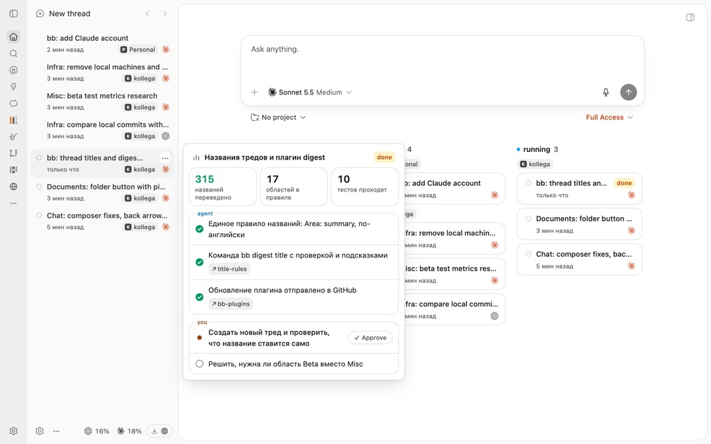
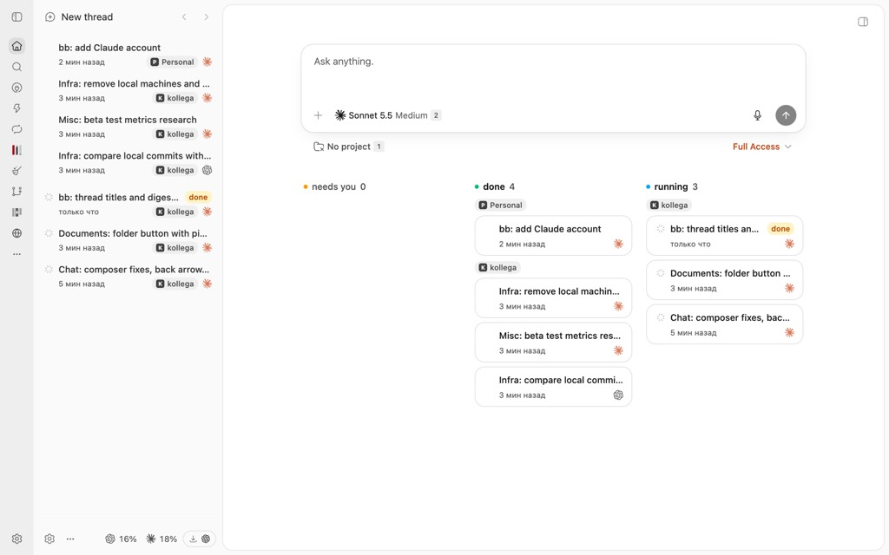

# bb-plugin-digest

Плагин для [bb](https://getbb.app): не тонуть в сотнях тредов.

1. **Карточка-сводка при наведении.** Агент в конце хода пишет короткую сводку
   (заголовок, метрики, что сделано, что ждёт вас). Наведите мышь на тред в
   сайдбаре или на доске, и она всплывёт рядом: можно решить, нужен ли вам этот
   тред, не открывая его. Кнопка **Approve** отправляет в тред «Одобрено: …».
2. **Компактный список тредов в сайдбаре.** Две строки на тред: название и
   бейдж (`review`, `question`, `error`), время, проект и логотип агента.
   Группы: закреплённые, нужен ты, в работе, готово, «Раньше» (свёрнуто).
3. **Доска на экране нового треда.** Колонки **needs you / done / running** со
   сгруппированными по проекту карточками.





## Установка

Нужен bb 0.49 или новее.

```sh
git clone https://github.com/<автор>/bb-plugin-digest.git
cd bb-plugin-digest
npm ci
bb plugin install .
```

Список тредов подключается сам. Вернуть встроенный:
Settings → Appearance → Sidebar, либо отключить плагин.

## Как агент пишет сводку

Навык `skills/digest/SKILL.md` подхватывается bb автоматически и объясняет
агентам формат. Вручную:

```sh
bb digest set --data "$(cat <<'EOF_DIGEST'
{
  "title": "Проверка часов по полугодиям",
  "badge": "review",
  "metrics": [{"value": "34", "label": "урока"}],
  "done": [{"text": "Часы считаются по учебным неделям", "chips": ["schedule.ts"]}],
  "needs": [{"id": "check-ui", "text": "Проверить панель в браузере", "approvable": true}]
}
EOF_DIGEST
)"
```

Команды: `bb digest set`, `bb digest show`, `bb digest clear`. Лимиты полей
описаны в `bb digest set --help` и в навыке.

Чтобы агенты писали сводку сами, добавьте в `AGENTS.md` проекта:

> В конце каждого хода, который сделал реальную работу или ждёт решения
> пользователя, запиши сводку треда через `bb digest set` (см. навык `digest`).

## Названия тредов

Плагин сам просит каждого агента на первом ходу дать треду название
`Area: summary`: по-английски, коротко, из фиксированного списка областей.
Команда проверяет название и отклоняет неверное с подсказкой.

```sh
bb digest title "Schedule: hours by school weeks"
bb digest title "Schedule: ..." --dry-run   # только проверить
```

Настройки (`bb plugin config digest`): `titleRule` (включить или выключить
просьбу агентам), `areas` (список областей через запятую), `maxLength`
(лимит длины, по умолчанию 50). Правила лежат в `lib/title-rules.ts`,
проверка: `npm test`.

## Как треды попадают в колонки

- **running**: агент работает.
- **needs you**: непрочитанное, вопрос агента, непрочитанная ошибка или
  открытый пункт «you» в сводке.
- **done**: остальное, что менялось за последние сутки. Старше уходит в «Раньше».
- В списках показаны корневые треды; дочерний виден, только пока ему нужен ты
  или он работает.

Правила лежат в `lib/classify.ts`.

## Ограничения

- Интерфейс на русском: подписи («мин назад», «Раньше», «Одобрено:») живут в
  `lib/classify.ts`, `components/` и `server.ts`.
- Список в сайдбаре заменяет встроенный целиком: нет переименования в строке,
  перетаскивания закреплённых и секций.
- Карточка по наведению работает только с мышью.
- Использует экспериментальные части Plugin SDK (`experimental_threadList`,
  `experimental_appOverlay`, `experimental_ThreadActionsMenu`); после обновления
  bb возможны поломки.
- Тестов нет.

## Разработка

```sh
npm ci
npx tsc --noEmit
bb plugin build
bb plugin reload digest
```
